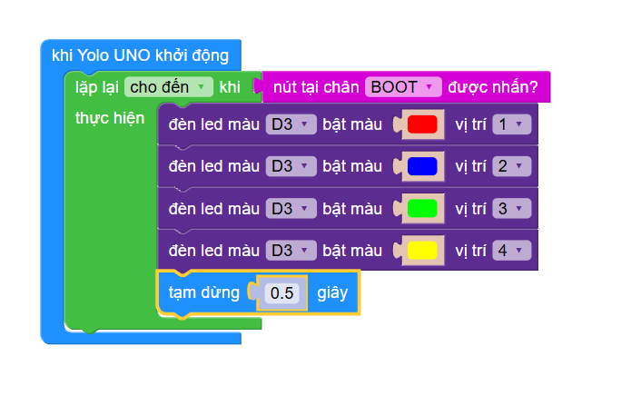

# Examples of Scratch at the Marie Curie School


There are only a few so far:

- [RGB Module](RGB_module)
- [Button RGB](Button_RGB)
- [RGB LED](RGB_LED)

So far we have pictures from the Scratch code - that's a little cumbersome to replicate. Here is the [Button RGB](RGB_module) as an example:



Easier to have the Python code (since it's running MicroPython on the ESP32-S3):

```py
from abutton import *
from yolo_uno import *

btn_BOOT= aButton(BOOT_PIN)

def deinit():
  btn_BOOT.deinit()

import yolo_uno
yolo_uno.deinit = deinit

async def setup():

  print('App started')
  while not btn_BOOT():
    neopix.show(0, hex_to_rgb('#ff0000'))
    await asleep_ms(100)
    neopix.show(0, hex_to_rgb('#ffa500'))
    await asleep_ms(100)
    neopix.show(0, hex_to_rgb('#ffff00'))
    await asleep_ms(100)
    neopix.show(0, hex_to_rgb('#00ff00'))
    await asleep_ms(100)
    neopix.show(0, hex_to_rgb('#0000ff'))
    await asleep_ms(100)
    neopix.show(0, hex_to_rgb('#4b0082'))
    await asleep_ms(100)
    neopix.show(0, hex_to_rgb('#800080'))
    await asleep_ms(100)

async def main():
  await setup()
  while True:
    await asleep_ms(100)

run_loop(main())
```

## Subtitle - this it is

- list item
- Another one

## Arduino

Installing Arduino and running C code on the Yolo UNO is a little challenging - and currently with errors. We wait how the ticket [AITT-VN/ohstem_arduino_board#2](https://github.com/AITT-VN/ohstem_arduino_board/issues/2) will be resolved.

## Reinstall the original firmware

Usually the Yolo UNO runs MicroPython v1.26.1-dirty on 2026-10-04; Yolo UNO with ESP32S3 - and you can reinstall it with the website [fw.ohstem.vn](https://fw.ohstem.vn/).
